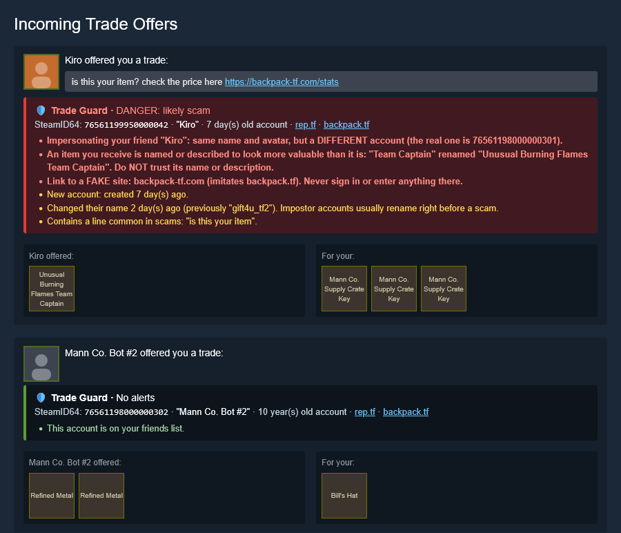
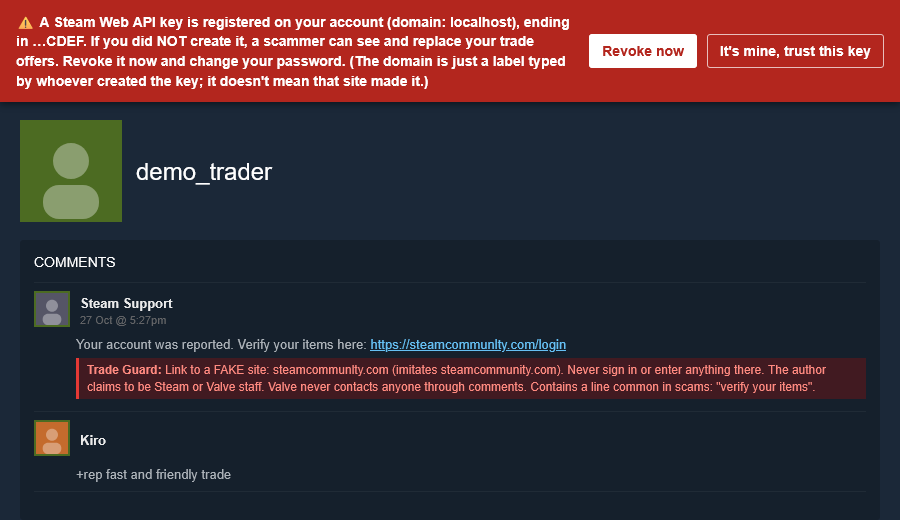

# TF2 Trade Guard

[](https://github.com/dns144444-del/tf2-trade-guard/actions/workflows/test.yml)

A userscript that protects Steam traders from the scams that empty the most TF2 inventories:

1. **The API key scam.** A phishing site registers a Steam Web API key on your account. With it, the scammer watches your trade offers, cancels the real one and instantly sends you an identical offer from an impostor account.
2. **Impostor accounts.** Someone copies the name and avatar of your friend, a middleman or a well-known trading bot.
3. **Fake items.** A cheap item gets a Name Tag or Description Tag that makes it look like an Unusual, an Australium or a key.
4. **Phishing links.** A message or comment sends you to a copy of Steam or a trading site to steal your login.





*The real script running on a simulated Steam page, with fictional accounts.*

## What it does

**API key watch** (every Steam Community page)
- Checks `steamcommunity.com/dev/apikey` in the background (at most every 15 minutes, every 2 minutes on trade pages).
- If a key is registered, shows a red banner on every Steam page with a button to revoke it.
- If the key is yours (e.g. for your own bot), you can trust it. Only a SHA-256 fingerprint and the last 4 characters are stored, never the key itself. A *different* key triggers the alert again.

**Trade offer checks** (offer list and trade window)
- Shows the partner's **SteamID64**, account age and links to rep.tf and backpack.tf.
- **Impostor detection:** compares the partner's name and avatar against your friends list and everyone you've traded with in the last 90 days. A different account with the same name, or a copied avatar with a similar name, is flagged in red. Lookalike tricks are caught too: Cyrillic, Greek, Armenian and Cherokee letters (capital and small), small capitals, letters in boxes, circles and flag symbols, zero-width and "blank" characters, combining marks, right-to-left overrides that flip a name, and `I`/`l`/`1`/`!`, `0`/`O`, `rn`/`m`, `vv`/`w`. A shared avatar alone is only a warning, since official Steam avatars are used by thousands of accounts.
- A friend added recently doesn't get the benefit of the doubt that long-standing friends get ("I lost my account, add my new one" is a classic opener). An old, public account sharing a past partner's name gets a yellow "check the site's bot list" instead of red, since some sites run several bots with one name; new, private or just-renamed copies stay red.
- Warns when a name contains a SteamID64 or text-direction controls, both used to make a fake name look trustworthy. The real SteamID64 is always shown first in the panel, before the quoted name.
- **Copied-offer detection:** flags an incoming offer that asks for the same items as an offer you recently had with another account. It checks your offer history too, because the real offer is usually canceled seconds before the copy arrives, often before you ever see it. Giving the same items for nothing is flagged red; the same deal on both sides is flagged yellow, since it can also be two buyers offering the same price.
- **Name history:** warns when the partner changed their name in the last 7 days and shows their previous name. Impostor accounts usually rename right before a scam.
- Warns about trade-banned, new (under 6 months), private and limited accounts.
- **Account age even for private profiles:** Steam hands out account IDs in order, so the SteamID alone dates an account. Trade Guard ships a table of real reference points (2004–2025, typically within ~10 days) and refines it locally from every public profile it sees. This also fixes Steam sometimes omitting the year of a creation date.
- Warns when you're giving items and receiving nothing. In the trade window this updates live.
- **Fake-named items:** checks every item you'd receive for a Name Tag or Description Tag and shows its real name. If the custom text claims something the item doesn't have (an unusual effect, Australium, Strange, a key…), the offer is flagged red. In a new offer this updates live as items are added.
- **Phishing links and scam lines in offer messages:** links to lookalike domains of Steam or trading sites (`steamcommunlty.com`, `backpack-tf.com`, lookalike letters, punycode, `steamcommunity.com@other-site`) are flagged red, other links yellow, and common scam lines ("is this your item?", "vote for my team", "your account will be banned") yellow.
- **Fake staff:** a partner whose name claims to be Steam or Valve staff ("Steam Support", "Valve Admin") is flagged red. Valve staff never trade.

**Comments** (profiles, groups, workshop)
- Comments with lookalike links, scam lines or authors posing as Steam/Valve staff get a warning note. Normal comments are left alone. Forum threads are skipped, where "contact Steam Support" is ordinary advice.

## Privacy and security

- **Only talks to `steamcommunity.com`.** It makes no request to any other domain, has no `@connect` entries and doesn't use `GM_xmlhttpRequest`.
- Doesn't read cookies or your session ID, and never sends, accepts or modifies trade offers. It only adds warning panels.
- Everything it remembers (friends, past trade partners, cached profiles) stays in Tampermonkey's local storage. Data about your account is kept per Steam account, so alts on the same browser never mix.
- Names from Steam are inserted as plain text, never as HTML.
- **It fails loudly.** If a check can't run (Steam changed a page, a request failed, the friends list didn't load), you get a yellow warning instead of a green "No alerts".
- Trusting your own API key requires typing its domain, so a phishing page can't talk you into a single click.
- Found a security issue, or a way to get past a check? Please report it privately, see [SECURITY.md](SECURITY.md).

## Install

1. Install [Tampermonkey](https://www.tampermonkey.net/) or [Violentmonkey](https://violentmonkey.github.io/).
2. Download `tf2-trade-guard.user.js` from the [latest release](../../releases/latest) and confirm the install.
3. Optional but recommended: check that the file's SHA-256 matches the one in the release notes.
   - Windows (PowerShell): `Get-FileHash .\tf2-trade-guard.user.js`
   - Linux/macOS: `sha256sum tf2-trade-guard.user.js`

### Updates are manual, on purpose

The script declares `@downloadURL none`, so Tampermonkey never updates it on its own. If this GitHub account were ever compromised, a malicious version would not reach anyone who already has the script installed. To update, install the new release the same way and check its hash.

## Limitations

- It warns you, it can't stop you. Always check the items and the partner in the Steam Guard mobile confirmation.
- Impostor detection only knows your friends and the partners it has seen while installed. A first contact with an impostor of a bot you've never traded with can't be detected by name.
- Item checks need Steam to describe each item: in a new offer they read the partner's public inventory, so a private inventory (or Steam's rate limit) means a yellow "couldn't check every item" instead.
- Phishing detection knows Steam and the main TF2 trading sites. A phishing site that imitates something else only gets the generic "unknown link" warning.
- Avatar matching uses Steam's image hash. A slightly edited copy of an avatar gets a new hash, so the name checks are what catch it.
- Trade Guard's panels never appear *inside* an offer's message. Text there that looks like a Trade Guard verdict was written by the other person.
- It relies on Steam's page structure and profile XML. If Steam changes them, the affected checks show a warning instead of a false "all clear".

## Development

The userscript is a single file with no dependencies, so what you read here is exactly what you install.
It has three parts: `Core` (pure detection logic), `Page` (reads Steam's markup) and the browser layer.
The tests cover all three:

- `tests/core.test.js`: the detection logic, with cases taken from real data.
- `tests/page.test.js`: page parsing, on HTML fixtures shaped like Steam's pages.
- `tests/userscript.test.js`: the whole script running on a simulated Steam page.
- `tests/source.test.js`, `tests/style.test.js`: no hidden characters, no HTML built from strings, one style.

```sh
npm ci --ignore-scripts   # test-only dependency: linkedom, a small DOM for Node
npm test
```

See [CHANGELOG.md](CHANGELOG.md) for the changes in each release.

## License

[MIT](LICENSE)
